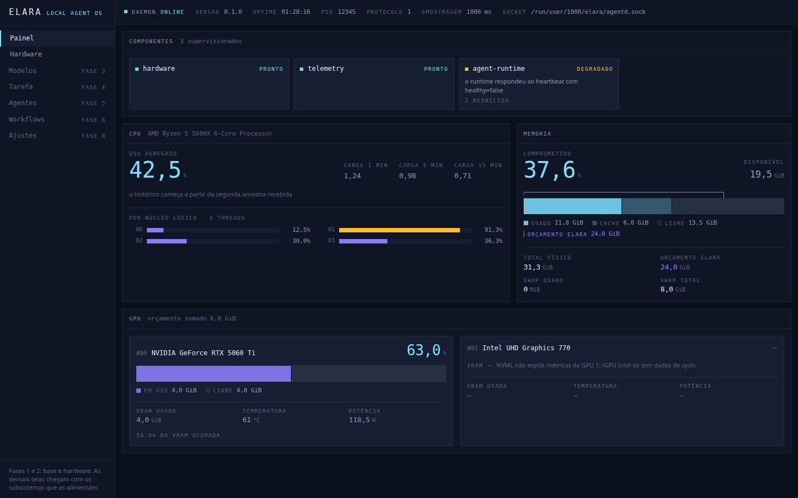
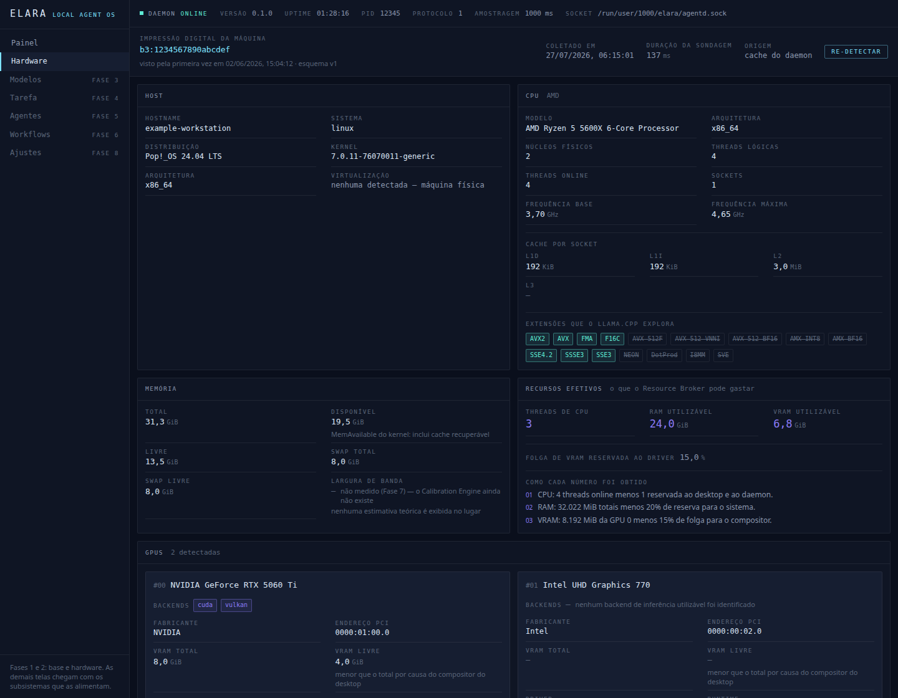
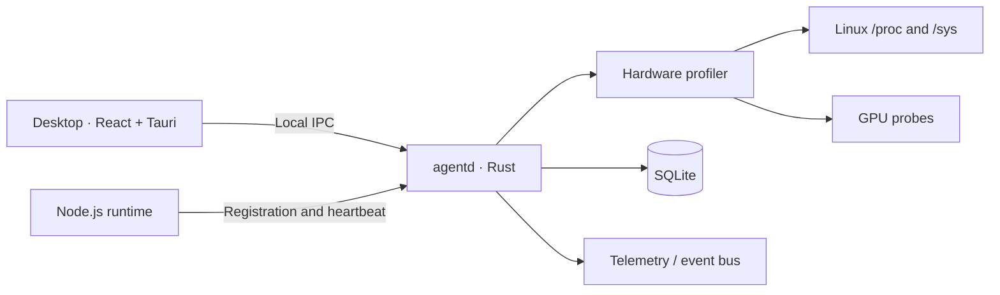

# Elara

**A hardware-aware foundation for local AI runtimes.**

English · [Português (Brasil)](README.pt-BR.md) · [Apache 2.0](LICENSE)

Elara explores a simple engineering principle: a local AI runtime should understand the resources available on its host before deciding what it can execute. The project starts with the foundation for that decision, measuring CPU, memory, GPUs and operating-system constraints rather than guessing a machine's capabilities.

> **Status: experimental foundation (phases 1–2).** Elara is a Linux-first daemon, hardware profiler, typed SDK and desktop interface. It does not yet execute agents, run inference or load models.

## What is implemented

| Component           | Capability                                                                                                               |
| ------------------- | ------------------------------------------------------------------------------------------------------------------------ |
| Daemon (`agentd`)   | Local HTTP over a Unix socket, SQLite state, runtime registration and heartbeat, server-sent events and orderly shutdown |
| Hardware profiler   | CPU topology and features, RAM, GPU detection, storage and NUMA; cgroup limits and reasoned effective resource budgets   |
| Runtime supervision | Optional Node.js process supervised by the daemon, bounded backoff and graceful termination                              |
| Typed client        | Rust types generated into TypeScript using ts-rs; Zod validates messages crossing the IPC boundary                       |
| Desktop             | Tauri 2 + React 19 dashboard and hardware profile, with unavailable measurements shown as unknown                        |
| Telemetry           | Structured logs, a sequenced event bus and periodic resource sampling                                                    |

## Desktop screenshots

The actual React desktop frontend rendered in a browser with the project's existing
test fixtures as its mocked Tauri IPC responses. All displayed data is sample data;
these are not measurements from a real host or a packaged Tauri end-to-end run.





## Architecture at a glance



The daemon coordinates local state and events. The desktop and the runtime use the same protocol; the hardware layer is kept separate so probes can be tested against fixtures rather than requiring a particular physical machine.

## Engineering decisions

| Decision                                       | Why it matters                                                                            | Trade-off                                                       |
| ---------------------------------------------- | ----------------------------------------------------------------------------------------- | --------------------------------------------------------------- |
| Linux Unix socket instead of a network service | Keeps the interface local and uses OS-level filesystem permissions                        | Linux-specific design; not a portable remote API                |
| Facts before estimates                         | Unknown measurements remain absent and carry a reason, rather than being reported as zero | Consumers must handle partial profiles                          |
| Separate supervision and IPC                   | Process lifecycle is separate from presentation and hardware probing                      | Cross-process protocol evolution needs coordination             |
| Rust-generated TypeScript types plus Zod       | Compile-time consistency and runtime validation at language boundaries                    | Generated contracts need synchronization when Rust types change |
| SQLite for local state                         | Simple local persistence without an additional database service                           | A single-host storage design, not a distributed state store     |

For details and documented technical limitations, see [architecture](docs/architecture.md), [hardware profiler](docs/hardware-profiler.md), [IPC protocol](docs/ipc-protocol.md) and [contracts](docs/contracts.md) (Portuguese).

## Try the foundation locally

Prerequisites: Linux, Node.js >= 22.13, pnpm 11.13.0, stable Rust (edition 2024), rustfmt and Clippy. Desktop compilation also requires the WebKitGTK 4.1 and libsoup 3 development libraries. GPU drivers are optional; discovery can fall back to Linux system interfaces.

```sh
pnpm check:env
pnpm install
pnpm dev
```

Development starts the daemon before the desktop and uses a separate development socket and state directory. To start components separately:

```sh
pnpm dev:daemon
pnpm dev:desktop
pnpm dev:runtime
```

## Validation

```sh
pnpm check          # formatting, lint, type checks and tests
pnpm bindings:check
```

The existing repository documentation records automated Rust and TypeScript tests covering probes, contracts, communication, supervision and telemetry. Those tests are not evidence of production use or an inference benchmark. The documented roadmap also notes that an interactive desktop-to-daemon end-to-end session and packaged desktop build had not yet been verified.

## Roadmap, not current features

The next work includes a model catalogue, inference engine, single task execution, agents and memory, workflow composition, resource calibration and resource brokerage. There is no model downloading, agent execution, inference backend or cloud escalation in the current foundation.

See the [roadmap](docs/roadmap.md) for details and known limitations.

## Repository layout

```
apps/      Desktop UI and Node runtime
crates/    Rust daemon, hardware, supervision, telemetry
packages/  Schemas, SDK and shared utilities
scripts/   Environment checks and development tooling
docs/      Architecture and implementation notes
```

This is an experimental engineering project, not a production-ready local AI platform.

## License

[Apache License 2.0](LICENSE).
